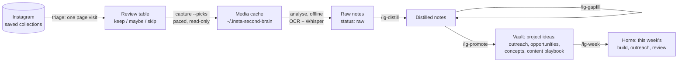

# insta-second-brain

Turn your saved Instagram folders into a second brain in Obsidian. Every saved post or reel becomes a note with what is said (local Whisper transcript), what is shown (OCR and key frames) and the caption. The notes then feed project ideas, outreach templates, opportunities and study notes in the rest of your vault.

Everything runs on your own machine. Instagram is read only, slowly, with your own login.

## How it works

| Stage | Tool | Touches Instagram |
|---|---|---|
| `triage` | `scripts/sweep.py` | one page visit per folder |
| `capture` | `scripts/sweep.py` | yes, one post at a time with 12-25 s pauses; stops on any challenge page |
| `analyse` | `scripts/sweep.py` + [doughrun/instagram-scraper](https://github.com/doughrun/instagram-scraper) | no |
| distill, gap-fill, promote, weekly plan | slash commands in `commands/` | no |

Instagram access goes through [YoppaV/instagram-mcp](https://github.com/YoppaV/instagram-mcp). Both tools are pinned to audited commits; see [docs/setup-windows.md](docs/setup-windows.md).

## What a note looks like

A made-up example: [docs/demo/example-note.md](docs/demo/example-note.md). The format is in [docs/note-format.md](docs/note-format.md).

## Getting started

1. [Set up the tools](docs/setup-windows.md) and log in once in the browser window.
2. Create the vault area: `python scripts/bootstrap_vault.py --vault "<vault>"`.
3. Install the commands: `python scripts/install_commands.py --vault "<vault>"`.
4. [Sweep a folder](docs/sweep.md): `triage`, mark rows keep, `capture --picks`, `analyse`.
5. In Claude Code: `/ig-distill`, `/ig-gapfill`, `/ig-promote`, then `/ig-week`.

| Command | Does |
|---|---|
| `/ig-query <question>` | answers from the notes, with citations |
| `/ig-distill` | turns raw captures into summaries |
| `/ig-gapfill` | finds primary sources for what gated posts name |
| `/ig-promote` | sends ideas, techniques and concepts into the rest of the vault |
| `/ig-week` | picks one build, one outreach and the reviews for this week |
| `/ig-draft <what>` | drafts an email, plan or script from the notes |

`sweep.py collections --counts` gives the exact post count of every collection in one page visit, which helps pick what to triage first. `scripts/weekly.py` runs capture and analyse for a few collections on a schedule and stops on any Instagram challenge.

Housekeeping: `scripts/vault_health.py` (report-only checks) and `scripts/cleanup.py` (removes sessions and caches, dry run by default).

## Privacy and risk

- This repo holds code and docs only. Notes, sessions, cookies and media are gitignored, and `scripts/check_no_secrets.py` fails the commit and CI if one slips in.
- Reading a logged-in account with third-party tools is against Instagram's terms and can get an account flagged. Read [docs/risk-controls.md](docs/risk-controls.md) first; use a secondary account if you can.
- Many posts gate their real content ("comment a keyword"). The notes say so instead of guessing.

## License

MIT
